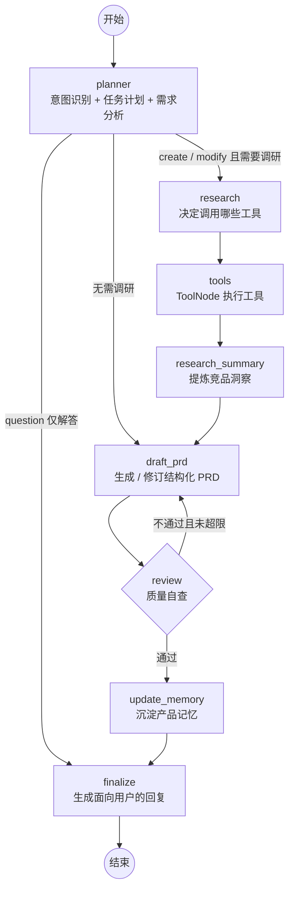

# 上策 ShangCe · AI 产品经理 Agent

> **一言上策，PRD 立现。** 输入一个产品想法，上策自动完成需求分析、竞品调研、结构化 PRD 生成与质量自查，并支持多轮对话持续修改。全程可见 Agent 执行过程（任务规划、工具调用、反思循环），不暴露模型思维链。

「上策」取"上策良谋"之意 —— 把模糊的想法，变成可落地的产品方案。

---

## ✨ 核心特性

| 能力 | 实现 |
| --- | --- |
| 🤖  Agent | LangGraph 实现 **规划 → 执行 → 反思** 循环：Planner 制定任务计划 → Researcher 调用工具调研 → Drafter 生成 PRD → Reviewer 质量自查（不通过则携带反馈重写，最多一轮） |
| 🧰 工具调用 Tool Calling | ① `search_competitors` 竞品搜索（有 DeepSeek Key 时使用 DeepSeek 官方联网搜索，否则回退内置竞品知识库）② `query_knowledge_base` 行业知识查询（8 大领域：用户特征/痛点/商业模式/关键指标/趋势） |
| 🧠 双层记忆 Memory | ① **产品记忆**：跨轮次沉淀产品关键事实（目标用户、商业模式、约束…），注入后续每轮对话，可在界面查看 ② **会话记忆**：LangGraph SQLite Checkpointer 持久化每个项目的图执行状态，支持断点续跑 |
| 📄 结构化 PRD | Pydantic 强约束输出（function calling），10 大模块：概述/目标用户/用户故事/功能清单（含验收标准）/竞品分析/数据指标/里程碑/风险/变更日志/待确认问题，可一键导出 Markdown |
| 🔄 多轮对话修改 | 自动识别 create / modify / question 三种意图；修改时保留未涉及内容、追加变更日志、版本号递增、同步更新产品记忆 |
| 👁️ 可见的执行过程 | 前端实时展示任务计划清单打勾、节点进度、工具调用输入输出、自查评分 —— 展示工作成果而非思维链 |
| 👤 用户系统 | 注册 / 登录（HMAC 签名令牌，密码 PBKDF2 加盐哈希），项目按用户隔离，多设备可各自使用 |
| ⚙️ 前端配置 LLM | 设置弹窗配置 DeepSeek API Key / 模型，保存后**热更新立即生效**，无需重启；Key 按用户隔离、脱敏显示、可一键清除 |
| 🌐 局域网访问 | 服务绑定 0.0.0.0，同一 Wi-Fi 下其他设备（手机/平板/同事电脑）通过 `http://<本机IP>:8080` 直接访问 |
| 🐳 一键启动 | Docker Compose 三行命令运行；**零配置演示模式**：无 API Key 也能完整体验 Agent 全流程（流程与工具真实执行，内容为模板），配置 Key 后自动切换真实 LLM |

## 🏗️ 系统架构

```
┌──────────────┐     ┌──────────────────────────────────────────────┐
│   浏览器      │     │                 后端 (FastAPI)                │
│  React 前端   │ SSE │                                              │
│ 聊天/PRD面板  │◄───►│   /api/chat ──► LangGraph Agent ──► 工具集    │
└──────────────┘     │      │                        │              │
      :8080          │      │                        ├─ search_competitors
                     │      │                        └─ query_knowledge_base
                     │      │                              │          │
                     │      │                        DeepSeek搜索 内置知识库
                     │      │                              │          │
                     │      ▼                              ▼          │
                     │   SQLite（SQLAlchemy）   LangGraph Checkpointer   │
                     │   项目/消息/执行记录/记忆    （会话状态持久化）      │
                     └──────────────────────────────────────────────┘
```

### Agent 执行图（LangGraph）



每个轮次 = 一次图执行；每个节点/工具的执行事件通过 SSE 实时推送到前端。

## 🚀 快速开始

### 方式一：Docker 一键启动（推荐）

```bash
cd shangce
docker compose up --build
```

打开 **http://localhost:8080** 即可使用（默认演示模式，无需任何配置）。

### 接入真实 LLM（强烈建议）

启动后打开 **http://localhost:8080**，注册/登录，点击左下角 **⚙️ 设置**（图片中红色箭头处），填入 DeepSeek API Key（在 [platform.deepseek.com](https://platform.deepseek.com) 获取），保存后立即生效。


- Key 按用户隔离保存在服务器数据库中，每个用户使用自己的 Key；
- 同一把 DeepSeek Key 同时用于 LLM 推理和官方联网搜索；
- 未配置 Key 时进入**演示模式**：Agent 的规划、工具调用、反思、记忆全流程真实执行（工具返回内置知识库的真实数据），仅"AI 生成内容"部分为确定性模板，用于零配置体验与联调。

### 局域网访问（同一 Wi-Fi 的其他设备）

服务已绑定所有网卡，同一 Wi-Fi 下用 **`http://<本机IP>:8080`** 访问（查 IP：`ipconfig` 看 IPv4 地址）。若其他设备无法访问，多半是 Windows 防火墙拦截，以管理员身份运行：

```bat
netsh advfirewall firewall add rule name="shangce-8080" dir=in action=allow protocol=TCP localport=8080
```

本地开发模式同理：后端 `main.py` 监听 0.0.0.0:8000，前端 `npm run dev` 已开启 `host: true`（5173），放行端口 5173 即可。

### 公网远程访问（任何网络、任何设备）

**方式 A：Cloudflare 快速隧道（零注册，开箱即用）**

先下载安装 Cloudflare cloudflared（https://developers.cloudflare.com/cloudflare-one/connections/connect-networks/downloads/），确保 Docker 服务已在运行，然后在终端执行：

```bash
cloudflared tunnel --url http://localhost:8080 --no-autoupdate
```

窗口里会出现一个公网地址（形如 `https://xxxx.trycloudflare.com`），**任何设备、任何网络**直接浏览器打开即可，自带 HTTPS。特点：免费、无需账号；但每次重启地址会变，且无可用性保证——适合面试演示、临时分享。

**方式 B：固定域名隧道（长期使用）**

- 注册 Cloudflare 账号（免费）+ 绑定一个域名（几块钱一年），创建 Named Tunnel → 地址固定、自带 HTTPS，免费不限流量
- 国内替代：cpolar / 花生壳，注册后同样可获得固定公网域名，国内访问速度更稳

**方式 C：部署到云服务器（最正式）**

任意一台 VPS（阿里云/腾讯云轻量服务器等）上装好 Docker，把仓库传上去 `docker compose up -d --build`，开放 8080 端口即可，配合域名与 HTTPS 即可长期对外服务。

> ⚠️ 安全提示：公网暴露后任何人都能访问注册页面。若配置了付费 API Key，建议在设置页保持演示模式，或后续增加注册白名单/邀请码机制（当前版本为开放注册）。公网部署前请覆盖后端默认的 `SECRET_KEY`（可在 docker-compose 的 environment 中配置），不要使用开发默认值。

### 方式二：本地开发

**PyCharm 一键运行（推荐）**

1. 创建虚拟环境并安装依赖（首次）：
   ```bash
   python -m venv .venv
   .venv\Scripts\python -m pip install -r backend\requirements.txt
   ```
2. PyCharm 右下角解释器 → Add Local Interpreter → Existing → 选择 `.venv\Scripts\python.exe`
3. 直接 Run 根目录的 **`main.py`** → 后端启动于 http://127.0.0.1:8000
4. 前端另开终端：`cd frontend && npm install && npm run dev` → http://localhost:5173（已配置 /api 代理）

**命令行方式**

```bash
# 后端（需 Python 3.10+）
cd backend
pip install -r requirements.txt
uvicorn app.main:app --reload  # http://localhost:8000（未配置 Key 为演示模式，启动后在页面设置里填 DeepSeek Key）

# 前端（需 Node 18+）
cd frontend
npm install
npm run dev                    # http://localhost:5173（已配置 /api 代理）
```

运行测试（演示模式，无需外部依赖）：

```bash
cd backend && python -m pytest tests/ -v
```

## 💬 使用示例

1. **生成 PRD**：输入「做一个面向健身新手的 AI 健身教练 App，核心功能是生成个性化训练计划」→ 观察右侧执行过程：任务计划逐项打勾 → 调用 `search_competitors` / `query_knowledge_base` → 生成 PRD → 质量自查评分 → 记忆沉淀。
2. **多轮修改**：「把目标用户改成大学生，并增加预算提醒功能」→ Agent 识别为 modify 意图，修订 PRD、追加变更日志、版本递增。
3. **查看与导出**：右侧面板查看完整 PRD 与产品记忆；点击「导出」下载 Markdown。

### 面试演示脚本（约 5 分钟）

| 步骤 | 操作 | 展示点 |
| --- | --- | --- |
| 1 | 输入产品想法 | 任务规划（Planning） |
| 2 | 展开"Agent 执行过程" | 工具调用（Tool Calling）的输入输出 |
| 3 | 打开右侧 PRD 面板 | 结构化 PRD 十模块 |
| 4 | 发送一条修改意见 | 多轮修改 + 变更日志 + 版本递增 |
| 5 | 切到"产品记忆"标签 | 记忆（Memory）可视化 |
| 6 | 点击"导出" | Markdown PRD 交付物 |

## 🧠 Agent 设计思路

### 1. 为什么是"规划-执行-反思"循环？

单次 LLM 调用生成 PRD 质量不稳定。上策把任务拆成显式的规划（Planner 输出 3~5 步任务计划，用户可见）→ 执行（Draft + Tools）→ 反思（Reviewer 按 5 项清单自查：完整性/一致性/可衡量性/优先级/可落地性）。不通过则携带具体反馈回 Draft 重写（最多 1 轮，防死循环）。反思循环是 Agent 区别于"套壳对话"的关键。

### 2. 工具层设计

- **工具即数据源**：Draft 节点只消费工具的返回内容，Prompt 明确要求"竞品分析只使用调研结果、不得编造"——把幻觉关进笼子。
- **优雅降级**：DeepSeek 官方联网搜索不可用时自动回退内置知识库，保证演示在任何网络环境可用；每次返回都标注数据来源。

### 3. 双层记忆

- **产品记忆（长期）**：`update_memory` 节点每轮从对话中提取值得长期记住的事实（key/value/category 结构化），Upsert 到 SQLite，并注入下一轮的 Planner / Draft / Memory 提示词 —— 实现"越聊越懂产品"。
- **会话记忆（短时）**：LangGraph Checkpointer 按项目持久化图状态；每轮输入的近期对话历史由 API 层注入，保证多轮上下文连续。

### 4. 结构化输出与可见性

所有 LLM 产出（计划、分析、PRD、评审、记忆）均通过 Pydantic schema + function calling 强约束，保证 PRD 可解析、可渲染、可导出、可 diff（变更日志）。执行过程通过 SSE 事件流推给前端：**展示任务、工具与结论，不展示思维链**。

### 5. 多轮修改机制

Planner 判别意图后，modify 路径将"现有 PRD + 用户修改要求 + 自查反馈"一并交给 Draft，要求只改相关部分、其余原样保留；修改点记录进 PRD changelog（版本 +1），同时更新产品记忆 —— 修改不是重新生成，而是受控演进。

## 📁 目录结构

```
shangce/
├── backend/                     # 后端：FastAPI + LangGraph
│   ├── app/
│   │   ├── main.py              # 应用入口（CORS、路由、生命周期）
│   │   ├── config.py            # 环境配置（LLM 服务商/Key/演示模式）
│   │   ├── db.py models.py      # SQLite（SQLAlchemy）：项目/消息/执行记录/记忆
│   │   ├── schemas.py utils.py  # API 模型、PRD→Markdown 导出
│   │   ├── agent/               # ★ Agent 核心
│   │   │   ├── state.py         # LangGraph 状态定义
│   │   │   ├── graph.py         # 图构建（规划-执行-反思循环）+ Checkpointer
│   │   │   ├── nodes.py         # 7 个节点实现（planner/research/summary/draft/review/memory/finalize）
│   │   │   ├── prompts.py       # 中文提示词
│   │   │   ├── tools.py         # 工具：竞品搜索 + 知识库查询
│   │   │   ├── prd_schema.py    # PRD 及中间产物的 Pydantic 结构
│   │   │   └── demo.py          # 演示模式确定性响应（零配置可运行）
│   │   └── routers/
│   │       ├── chat.py          # SSE 流式聊天 + 事件协议
│   │       └── projects.py      # 项目 CRUD、PRD 导出
│   ├── knowledge/domains.json   # 内置行业知识库（8 大领域）
│   ├── tests/                   # 图测试 + API 端到端测试（演示模式）
│   └── Dockerfile
├── frontend/                    # 前端：React + Vite（无 UI 框架依赖，纯手写样式）
│   ├── src/
│   │   ├── App.jsx              # 状态编排：SSE 事件 → 实时消息/步骤/PRD
│   │   ├── api.js               # SSE 流解析
│   │   └── components/          # Sidebar / ChatArea / ExecutionSteps / PrdPanel
│   ├── nginx.conf               # 静态资源 + /api 反代（SSE 关缓冲）
│   └── Dockerfile               # 多阶段构建（node build → nginx）
└── docker-compose.yml
```

## 🔌 API 一览

| 方法 | 路径 | 说明 |
| --- | --- | --- |
| POST | `/api/auth/register` | 注册（`{username, password}`），返回令牌 |
| POST | `/api/auth/login` | 登录，返回令牌 |
| GET | `/api/auth/me` | 当前用户 |
| GET/PUT | `/api/settings/llm` | 查询 / 修改当前用户的 LLM 配置（Key、模型），保存即热更新 |
| POST | `/api/chat` | 聊天（SSE 流式）；body `{message, project_id?}`，project_id 为空则创建新项目 |
| GET | `/api/projects` | 项目列表（仅当前用户） |
| GET | `/api/projects/{id}` | 项目详情（消息、执行记录、PRD、记忆） |
| DELETE | `/api/projects/{id}` | 删除项目 |
| GET | `/api/projects/{id}/prd.md` | 导出 PRD Markdown |
| GET | `/api/health` | 健康检查（含当前模式） |

> 除注册/登录/健康检查外，所有接口需携带 `Authorization: Bearer <token>`；项目按登录用户隔离。

SSE 事件：`project`（项目建立）→ `node`（7 类节点 running/done）→ `tool`（工具调用）→ `done`（本轮完成，含版本号）。执行记录同步落库，刷新页面后仍可回放。

## ⚠️ 说明与后续方向

- 演示模式仅用于零配置体验与联调，正式演示请配置 DeepSeek 等 API Key。
- 内置竞品知识库为人工整理的行业通识（截至编写时点），实时竞品信息请在设置中配置 DeepSeek API Key（使用 DeepSeek 官方联网搜索）。
- 后续可扩展：PRD 版本 diff 对比、与研发工具链集成（自动拆分开发任务/生成测试用例）、语音输入、多产品对比分析。

---

Made with LangChain · LangGraph · FastAPI · React
